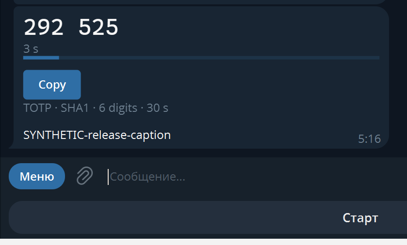

# Telegram TOTP Widgets

## Заявление автора

**Бот небезопасен, это полное говно по безопасности, не используйте его!**

Если вам понравилась эта идея, напишите Паше:

Павел и ко, ~~верни стену~~, пожалуйста, реализуй этот функционал в Telegram, в «Избранном»: если в сообщении есть ссылка на TOTP, отображать её как виджет.

Бот создаёт в личном чате Telegram автономные карточки с одноразовыми TOTP-кодами. Виджет вычисляет код на устройстве; база данных и серверный расчёт кодов не используются.

Поддерживаются SHA1, SHA256 и SHA512; коды из 6 или 8 цифр; секреты Base32 длиной 10–64 байта. Для добавления отправьте боту ссылку `otpauth://totp/...` или название и секрет двумя строками. Название отображается в подписи под карточкой и доступно поиску Telegram. Кнопка Copy копирует код без пробела.

## Безопасность

**Секрет хранится в данных сообщения Telegram и проходит через обработчик бота.** Доступ к сообщениям или устройству может раскрыть секрет и позволить вычислять будущие коды. Это не защищённое хранилище и не независимый второй фактор относительно скомпрометированного Telegram-аккаунта. Храните резервные ключи и коды восстановления отдельно. Подробнее: [отчёт по безопасности](docs/security-audit-ru.md).

## Размещение

Проект предназначен для Telegram Serverless. Потребуются созданный через BotFather бот, доступ к Serverless и поддерживающий виджеты клиент Telegram. Не размещайте токены и настоящие TOTP-секреты в репозитории.

Обработчик находится в `tgcloud/handlers/message.js`. В пакете вместо привязанного к исходному боту ID установлен `REPLACE_WITH_YOUR_SHARED_WIDGET_ID`: **перед использованием необходимо создать собственный общий виджет и подставить его идентификатор**. Для этого отправьте HTML, полученный из `renderSharedWidget()`, методом `sendWidget` с `is_shared: true`, и возьмите `widget.id` из ответа. Используйте только синтетические тестовые данные. Создание общего виджета приводит к отправке сообщения. Пошаговый инструмент первичного создания шаблона в этот пакет не входит; до настройки ID обработчик не готов к работе.

После подстановки ID разместите обработчик средствами Telegram Serverless и настройте приём сообщений. Размещение и первичная настройка на другом боте в рамках этого пакета не проверялись. Инструкции платформы: [Telegram Widgets](https://core.telegram.org/bots/widgets) и [Bot API](https://core.telegram.org/bots/api#sendsharedwidget).

## Исходники

`tgcloud/lib/` содержит читаемый парсер и код виджета; `scripts/runtime-bot.js` — логику обработчика. Сборка требует Node.js и Terser из `scripts/minifier`; зависимости сборки не нужны во время работы бота. Идентификатор общего виджета привязан к конкретному экземпляру бота и не переносится между ботами.

Исторический аудит относится к прежнему снимку кода и не является гарантией безопасности текущей версии. Полный прогон 2310 комбинаций для последней версии не подтверждён.
